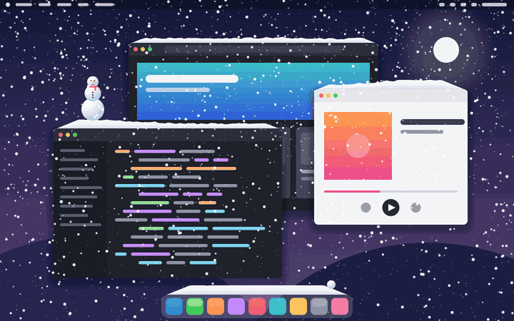

# Snowdesk

Снег на рабочем столе: падает поверх всех окон, копится сугробами на их верхних краях
и на Dock / панели задач, сугробы ездят вместе с окнами, а при резком рывке окна снег осыпается.
Из сугробов можно слепить снежки и снеговика, смахнуть снег курсором или вызвать снегоуборщик.
Клики проходят сквозь снег — работать он не мешает.

*Desktop snow for macOS, Windows and Linux (X11): snow piles up on window edges and the Dock/taskbar,
moves with windows, and can be rolled into snowballs and snowmen. Written in Rust (winit + wgpu).*




<sub>Рабочий стол на картинках выдуманный (его рисует `scripts/showcase.sh`), снег — настоящая симуляция из приложения.</sub>

## Платформы

| | Статус |
|---|---|
| **macOS 13+** (Apple Silicon и Intel) | основная платформа, проверено |
| **Windows 10/11** (x64) | собирается, **на живой системе не проверялось** |
| **Linux, X11** (x64) | собирается, **на живой системе не проверялось**; нужен композитный менеджер |
| Linux, Wayland | работает через XWayland: сугробы будут только на X11-приложениях — Wayland не даёт узнать, где чужие окна |

Если на Windows или Linux что-то не так — заведите issue со скриншотом и файлом `snowdesk.log`
из папки настроек (см. ниже).

## Установка

Готовые сборки — на странице [Releases](../../releases).

**macOS.** Распакуйте `Snowdesk-macos.zip`, перенесите `Snowdesk.app` в «Программы».
Приложение не нотаризовано, поэтому первый раз откройте его через правый клик → «Открыть»
(или `xattr -dr com.apple.quarantine /Applications/Snowdesk.app`). При первом запуске Snowdesk
попросит «Универсальный доступ» — он нужен только для снега на Dock: без него macOS не говорит,
где нарисована панель.

**Windows.** Распакуйте `Snowdesk-windows-x64.zip` и запустите `snowdesk.exe`. Сборка не подписана —
SmartScreen предупредит: «Подробнее» → «Выполнить в любом случае».

**Linux.** Нужны `libgtk-3-0`, `libayatana-appindicator3-1`, `libxdo3` и запущенный композитор
(в GNOME, KDE, Cinnamon он есть по умолчанию; без композитора Snowdesk не запустится, чтобы не
закрыть экран чёрным окном).

```sh
tar -xzf Snowdesk-linux-x64.tar.gz && ./snowdesk
```

## Как пользоваться

Всё управление — снежинка в строке меню / трее:

- **Снегопад**: лёгкий, ровный, метель; **ветер** влево/вправо.
- **Инструмент**:
  - *Варежка* — водите курсором по сугробу, снег слетает;
  - *Снежки* — зажмите кнопку мыши на снегу и катайте: шар подбирает снег и растёт.
    Отпустите над другим шаром — встанет сверху, из 2–3 шаров получается снеговик. Брошенный с
    размаху шар летит и может рассыпаться;
  - *Лопата* — клик по сугробу убирает весь снег с окна.
- ⌥ (macOS) / Ctrl (Windows, Linux) + курсор — смахнуть снег при любом инструменте.
- **Вызвать снегоуборщик** — трактор проезжает по Dock / панели задач и сгребает снег.
- **Эконом** — 30 кадров/с вместо 60 (включается сам в режиме энергосбережения).
- **Запускать при входе** — автозапуск.

Над полноэкранными играми и видео снег ставится на паузу.

Настройки и лог: macOS — `~/Library/Application Support/snowdesk/`, Windows — `%APPDATA%\snowdesk\`,
Linux — `~/.config/snowdesk/`.

## Сборка из исходников

Нужен [Rust](https://rustup.rs).

```sh
cargo run --release                  # собрать и запустить
SNOW_STATS=1 cargo run --release     # + раз в 5 с печатает fps и время кадра
cargo run --release -- --debug-windows   # какие окна и Dock видит программа
SNOW_DEMO=500,100 cargo run --release    # демо: три шара падают в точку (500, 100), потом снегоуборщик
./scripts/showcase.sh                    # перерисовать docs/screenshot.png и docs/demo.gif (нужен ffmpeg)
```

macOS: `./scripts/bundle.sh --install` собирает `Snowdesk.app` и кладёт в `/Applications`.
Чтобы доступ к Dock не слетал после каждой пересборки, один раз создайте свой сертификат
для подписи: `./scripts/make_cert.sh` — дальше `bundle.sh` подписывает им.

Linux: `sudo apt install libgtk-3-dev libayatana-appindicator3-dev libxdo-dev`.

Сборки под все три системы и релизы по тегу `v*` делает GitHub Actions (`.github/workflows/build.yml`).

## Устройство

| Файл | Что делает |
|---|---|
| `src/main.rs` | цикл кадров (winit), оверлей на каждый экран, мышь, связка платформы с физикой |
| `src/platform/` | всё, что зависит от ОС: экраны, список окон, Dock/панель задач, оверлей, автозапуск |
| `src/platform/macos.rs` | CGWindowList, Dock через Accessibility, NSWindow над строкой меню, SMAppService |
| `src/platform/win.rs` | EnumWindows + DWM, панель задач, DirectComposition, автозапуск через реестр |
| `src/platform/linux.rs` | X11/EWMH (x11rb), нижняя панель, override-redirect окно, `~/.config/autostart` |
| `src/sim.rs` | физика: снежинки, сугробы (столбики по 2 пт с углом откоса), стряхивание, варежка |
| `src/sim/toys.rs` | снежки, снеговик, лопата, снегоуборщик |
| `src/render.rs` | wgpu: инстансы-квадраты, форму (круг, трапеция сугроба, шар, морковка) делает шейдер |
| `src/tray.rs` | меню в трее; на Linux живёт в отдельном потоке GTK |
| `src/showcase.rs` | выдуманный рабочий стол для картинок в README (`--showcase`) |
| `examples/make_icon.rs` | рисует иконку приложения кодом |

Ключевые решения:
- Окна опрашиваются каждый кадр, сугроб привязан к id окна — поэтому едет вместе с ним.
- Столбик сугроба живёт только там, где верх окна не закрыт окнами спереди.
- Снег делится между стопкой окон: если перед окном есть окна ниже, оно ловит 1/(1+N) снежинок,
  иначе задние окна с более высоким краем съедают весь снег над передним.
- Оверлей ловит мышь, только пока курсор над снегом или шаром в режиме «Снежки»/«Лопата»,
  в остальное время клики проходят насквозь.
- Если система не даёт прозрачную поверхность, оверлей не показывается вовсе (а не закрывает экран).
- macOS: рамка Dock из Accessibility на (высота − tilesize)/2 выше видимой «таблетки» — сдвигаем;
  полноэкранный режим определяем по пропаже окна Dock (на маках с «чёлкой» окно начинается под ней).

Ресурсы на MacBook (M5, метель ~4000 снежинок): ~87 МБ памяти (из них ~53 МБ — буферы драйвера GPU),
~11% одного ядра при 60 кадрах/с, расчёт кадра ~2 мс.

## Лицензия

MIT
